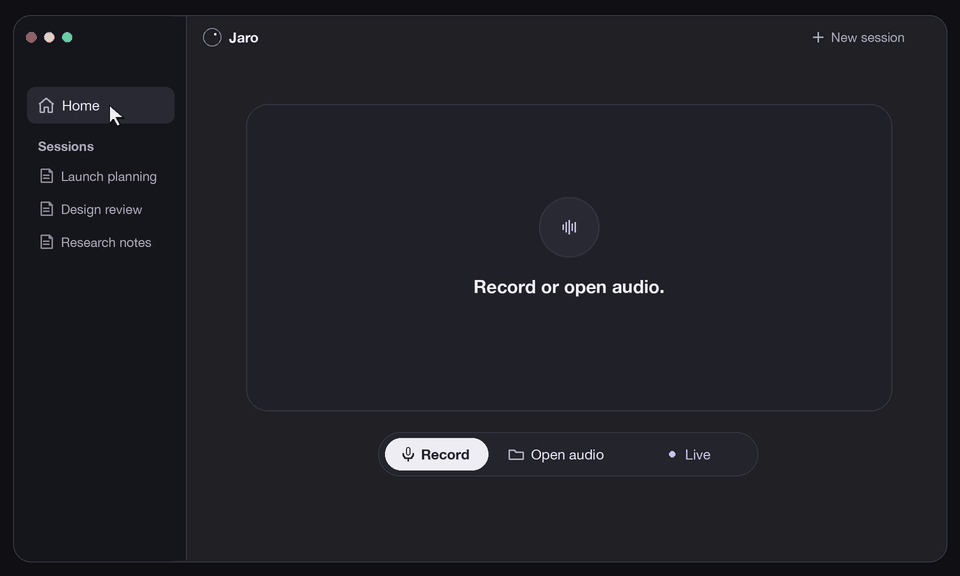

# Jard Soundfolio Local

Record meetings or open an audio file. Get a searchable transcript, an editable overview, and a timeline you can play back. Your recordings and notes stay on your Mac.

**[Download for Mac](https://github.com/AdamGera/Jard-Soundfolio-Local/releases/latest/download/Jard-Soundfolio-Local-arm64.dmg)** · Apple Silicon · macOS 26 or later

## How it works

1. From **Home**, choose **Record** to capture your microphone, Mac audio, or both. Choose **Open audio** if you already have a recording.
2. When transcription finishes, open **Overview** for a summary or **Timeline** to jump to a topic. Click a timestamp to hear that moment.
3. In **Transcript**, search for words or play a speaker’s turn. **Speaker analytics** shows when each person spoke and their share of speaking time.

Type or dictate in **My Notes** to add context, then choose **Update overview** to use it in the summary. You can also edit the overview directly or ask a question in **Chat**.

## Install

Open the DMG, drag Jard Soundfolio Local to **Applications**, and open it. First launch downloads about 4 GB of models. After setup, transcription, speaker labeling, and summaries work offline.

Allow microphone or Mac audio access when you first record from those sources. The app is signed by Jard, and macOS may require first-launch approval.

To update an existing copy, choose **Jard Soundfolio Local → Check for Updates…**. To use the same session library in your browser, choose **File → Open in Browser**.

## Why we made it

We wanted to get back to what someone actually said without sending the conversation away. We built Soundfolio at Jard (Joint AI Research & Dynamics) to make reviewing recordings on your own Mac easy. It’s free and open source. [About Jard](https://www.jard.ai/)

Soundfolio’s code is licensed under Apache 2.0. Rumble-2-Flash handles speech recognition, Nemotron 3 labels speakers, and Qwen3.5 writes summaries. [License](LICENSE) · [Rumble-2-Flash](https://huggingface.co/Reson8/Rumble-2-Flash) · [Nemotron 3](https://huggingface.co/nvidia/Nemotron-3-Diarization) · [Qwen3.5](https://huggingface.co/axteam/Qwen3.5-2B-GGUF)
