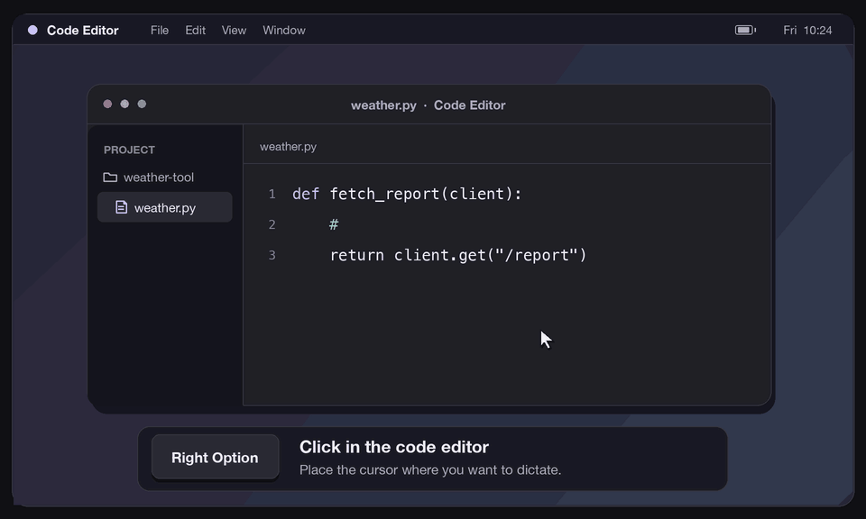

# Jaro — By Jard

Jaro is a local audio app for Mac. Dictate into the app you’re already using, record meetings, or transcribe an audio file. Transcription runs on your Mac.

**[Download for Mac](https://github.com/AdamGera/Jaro/releases/latest/download/Jard-Soundfolio-Local-arm64.dmg)** · Apple Silicon · macOS 26 or later

## Meetings

Record your microphone, Mac audio, or both. You can also open a recording you already have.

Open **Overview** for an editable summary or **Timeline** to jump to a topic. Search the **Transcript** and click a timestamp to hear that moment. **Speaker analytics** shows when each person spoke and their share of speaking time.

Type or dictate in **My Notes** to add context, then choose **Update overview** to use it in the summary. You can also ask a question in **Chat**.

## System Dictation

Use your voice to write a code comment, give a coding agent a task, or reply in a chat. The demo shows a preview of System Dictation.

1. Open **Settings → System Dictation** and allow **Microphone** and **Accessibility** access.
2. With Jaro running, click where you want the text to go. Hold **Right Option** and speak.
3. Release **Right Option**. Jaro inserts the text at your cursor.

Double-tap **Right Option** for hands-free dictation, then press it again to finish. [Dictation settings and shortcuts](docs/system-dictation.md)

## Install

Open the DMG, drag the app to **Applications**, and open it. First launch downloads about 4 GB of models. After setup, transcription, speaker labeling, and summaries work offline.

Allow microphone or Mac audio access when you first record from those sources. The app is signed by Jard, and macOS may require first-launch approval.

To use the same session library in your browser, choose **File → Open in Browser**.

## Why we made it

We built Jaro at Jard (Joint AI Research & Dynamics) to make it easy to return to what someone actually said and get your own thoughts into writing. Your recordings and notes stay on your Mac. [About Jard](https://www.jard.ai/)

Jaro is free and open source under Apache 2.0. [License](LICENSE) · [Model credits](NOTICE) · [Mac build details](desktop/build-tools/README.md)
